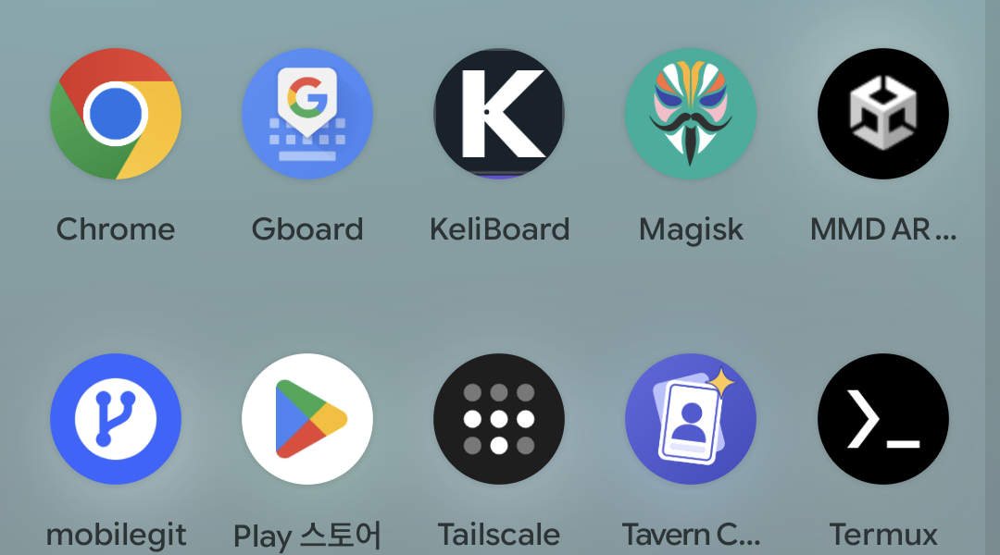
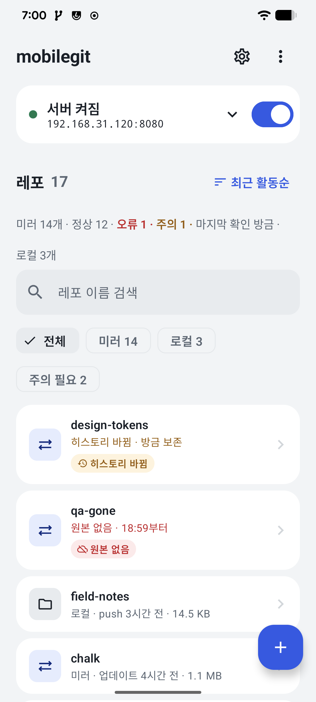
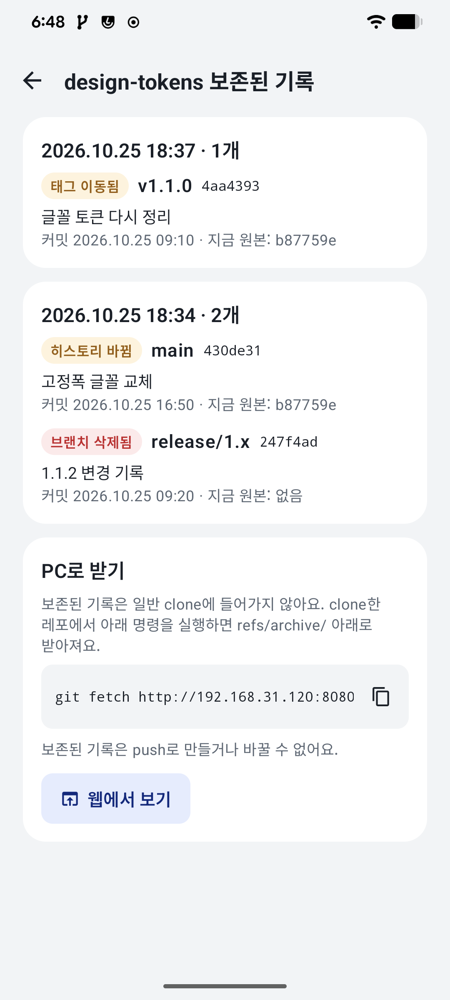
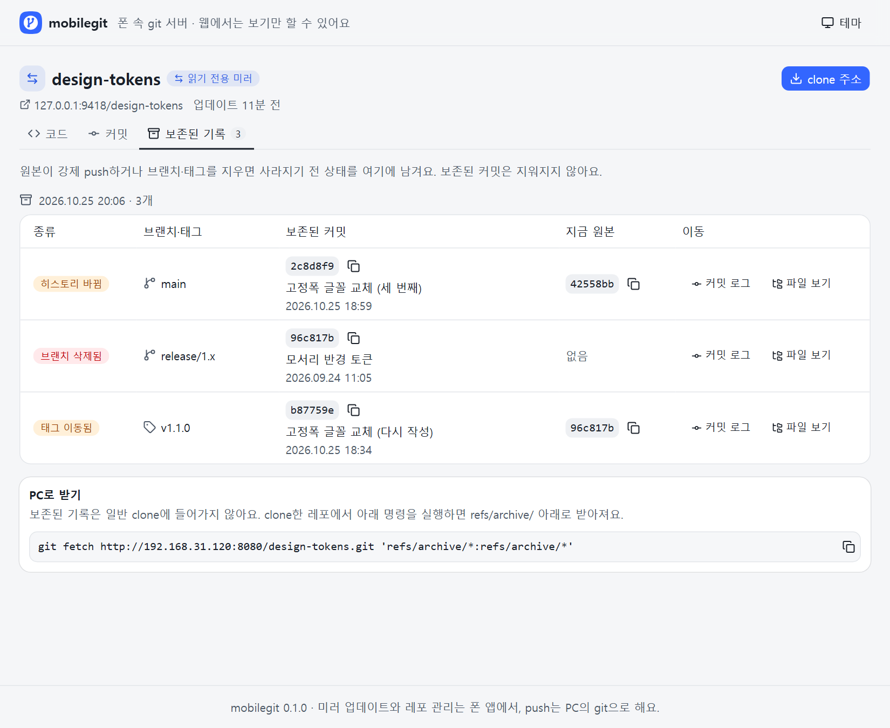

<div align="center">



# mobilegit

**안드로이드 폰을 git 서버이자 레포 금고로**

GitHub·GitLab 레포를 폰에 미러로 받아 두고, PC에서 폰으로 push해요.<br>
원본이 force-push되거나 지워져도 이전 기록은 폰에 남아요.

### [최신 릴리즈 (APK)](https://github.com/ouor/MobileGit/releases/latest)

</div>

> [!NOTE]
> **개인 프로젝트예요.** GitHub, GitLab, ngrok, Tailscale과 관련이 없고, 공식으로 제공하거나 승인한 앱이 아니에요. <br/>
> 폰 한 대가 레포의 유일한 복사본이 되지 않도록, 중요한 레포는 다른 곳에도 두세요.

## 📸 이렇게 써요

1. **레포 추가**: 오른쪽 아래 **레포 추가**에서 GitHub·GitLab 주소를 붙여 넣으면 미러로 받아 와요. 계정이나 조직 이름을 넣어 여러 레포를 한 번에 고를 수도 있어요.
2. **알아서 따라가기**: 미러는 정해 둔 주기마다 원본을 확인하고 바뀐 것을 받아요. 실패하거나 원본이 사라지면 목록 맨 위 요약과 알림으로 알려 줘요.
3. **PC에서 쓰기**: 메인 화면의 주소로 `git clone`하거나, 로컬 레포를 만들어 PC에서 `git push`해요. 브라우저로 같은 주소를 열면 파일과 커밋을 볼 수 있어요.

<div align="center">



</div>
<div align="center"><sub>메인 · 보존된 기록 · 웹 화면</sub></div>

## ✨ 할 수 있는 것

- **미러**: 공개 레포는 주소만, 비공개 레포는 원본 접속 토큰을 넣어 받아요. 등록 전에 브랜치·태그 개수와 받을 용량을 미리 보여 줘요. PR 브랜치는 기본으로 빼요.
- **계정·조직 한 번에**: 계정이나 조직의 레포 목록에서 포크와 아카이브된 레포를 숨기고 골라서 받아요.
- **보존된 기록**: 원본이 force-push하거나 브랜치·태그를 지우거나 태그를 옮기면, 이전 커밋을 `refs/archive/`에 남기고 "히스토리 바뀜"으로 알려 줘요.
- **상태가 한눈에**: "미러 12개 · 정상 11 · 오류 1"처럼 요약해 보여 줘요. 실패, 원본 없음, 토큰 확인 필요, 확인 지연을 레포마다 이유와 기간으로 알려 줘요.
- **로컬 레포**: PC에서 폰으로 push하면 레포가 생겨요. 빈 레포를 먼저 만들 수도 있고, 미러를 복사해서 로컬 레포로 만들 수도 있어요.
- **어디서든 접속**: 같은 와이파이·핫스팟·USB 테더링에서는 폰 주소로, 밖에서는 [Tailscale](https://tailscale.com) 주소로 접속해요. 필요하면 **외부 공개 (ngrok)**로 인터넷에 열 수 있어요(기본 꺼짐).
- **웹 화면**: 브라우저에서 레포 목록, 파일, README, 커밋 이력, 보존된 기록을 봐요. PC 브라우저에서 GitHub·GitLab 링크를 붙여 넣어 미러를 추가할 수도 있어요(외부 공개 주소에서는 막혀요).
- **내보내기**: 레포를 git 번들이나 소스 zip으로, 모든 레포를 전체 백업 zip으로 내보내요.
- **아끼면서 받기**: 와이파이에서만, 충전 중일 때만 자동 업데이트하도록 고를 수 있고, 최소 여유 공간 아래로는 받지 않아요.
- **주소 공유**: clone 주소를 복사하거나 QR로 보여 줘요. 주소에는 비밀번호가 들어가지 않아요.

### 이럴 때 써 보세요

- 의존하는 오픈소스 레포가 갑자기 사라지거나 히스토리가 바뀔까 걱정될 때
- GitHub가 막혀도 꺼낼 수 있는, 물리적으로 떨어진 복사본을 하나 더 두고 싶을 때
- 집이나 사무실에 남는 폰을 충전기에 꽂아 개인 git 서버로 쓰고 싶을 때
- 인터넷이 없는 곳에서 노트북 몇 대가 폰 핫스팟으로 레포를 주고받아야 할 때

### 하지 않는 것

SSH, Git LFS 파일(포인터만 받아요), 이슈·PR·위키, 웹에서 고치기, CI, 사람별 계정은 지원하지 않아요. 미러는 읽기 전용이라 push할 수 없어요.

## ⬇️ 설치하기

1. [최신 릴리즈](https://github.com/ouor/MobileGit/releases/latest)에서 `.apk` 파일을 받아요.
2. 받은 파일을 열어요. "출처를 알 수 없는 앱" 안내가 나오면 **설정**을 눌러 이 출처(브라우저나 내 파일)를 허용해요.
3. Play 프로텍트 경고가 뜨면 **세부정보 더보기 → 무시하고 설치**를 눌러요. Play 스토어를 거치지 않은 앱이라 뜨는 안내예요.
4. 처음 열면 앱이 서버 비밀번호를 만들어 한 번 보여 줘요. PC의 git이 비밀번호를 물으면 사용자 이름 `git`과 이 비밀번호를 넣어요. 비밀번호는 설정에서 바꿀 수 있어요.

**업데이트**는 새 버전 APK를 그대로 설치하면 돼요. 레포와 설정은 그대로 남아요.

> [!WARNING]
> **v0.1.0에서 올 때는 한 번 앱을 지우고 새로 설치해야 해요.** 다음 버전부터 정식 키로 서명해서, 안드로이드가 업데이트로 받아 주지 않아요.
> 지우면 폰의 레포와 설정도 함께 지워지니, 로컬 레포는 먼저 PC로 push하거나 저장 공간 화면의 **전체 백업 (zip)**으로 내보내 두세요. 미러는 다시 추가하면 원본에서 다시 받아요(보존된 기록은 다시 생기지 않아요).

이 저장소의 [릴리즈](https://github.com/ouor/MobileGit/releases)에서 받은 APK만 설치해 주세요. 정식 APK의 서명 인증서 SHA-256 지문은 아래와 같아요.

```
0B:21:82:B8:D7:42:E6:1A:72:C6:66:4A:F6:52:8E:5E:11:C8:42:97:2C:84:D0:92:B0:65:20:59:D4:79:37:8C
```

PC에서 `apksigner verify --print-certs mobilegit-*.apk`로 확인할 수 있어요.

### 필요한 것

- Android 8.0 이상, 64비트(arm64) 휴대폰
- 레포를 담을 저장 공간. 레포 하나는 1GB 이하를 권장해요.
- 밖에서 접속하려면 폰과 PC 모두 Tailscale, 또는 ngrok 계정과 토큰
- 앱 화면은 한국어로 나와요.

## 🔒 개인정보와 보안

- 레포는 **이 폰 안에만 저장돼요.** 앱이 통신하는 곳은 내가 추가한 원본(GitHub·GitLab 등)과, 외부 공개를 켰을 때의 ngrok뿐이에요. 광고와 분석 도구가 없어요.
- 서버 비밀번호와 원본 접속 토큰, ngrok 토큰은 안드로이드 키스토어로 암호화해서 보관해요. 토큰은 내보낸 파일에 넣지 않아요.
- **비밀번호 요구**는 기본 **항상**이에요. **push할 때만**이나 **안 함**으로 바꾼 채 외부 공개를 켜려고 하면 경고하고, 그래도 고르면 메인 화면에 위험 배너를 띄워요.
- 와이파이·핫스팟 접속은 암호화되지 않은 HTTP예요. 카페처럼 남과 함께 쓰는 와이파이에서는 Tailscale로 접속하세요.
- 내보낸 파일은 암호화되지 않아요. 레포 저장소 자체도 따로 암호화하지 않고 앱 잠금이 없으니, 폰 화면 잠금을 꼭 켜 두세요.
- 쓰는 권한은 인터넷·네트워크 상태, 알림, 백그라운드 실행(서버 유지와 주기적 확인), 부팅 뒤 자동 시작, 배터리 최적화 예외 요청이에요. 카메라, 위치, 연락처, 사진 권한은 쓰지 않아요.

## 🙋 자주 묻는 질문

| 이럴 때 | 이렇게 해 보세요 |
|---|---|
| PC에서 접속이 안 돼요 | 폰과 PC가 같은 와이파이인지, 메인 화면에서 서버가 켜져 있는지 확인해 주세요. 회사·학교 와이파이는 기기끼리 접속을 막기도 해요. 그럴 땐 폰 핫스팟이나 Tailscale을 써 보세요. |
| 비밀번호를 물어요 | 사용자 이름은 `git`, 비밀번호는 앱에서 정한 서버 비밀번호예요. 남과 함께 쓰는 PC에서는 git이 비밀번호를 저장하지 않게 해 주세요. |
| "백그라운드 확인이 멈췄어요"가 떠요 | 배터리 최적화 때문에 확인이 멈췄을 수 있어요. 배너를 눌러 mobilegit을 배터리 최적화에서 빼 주세요. |
| "토큰 확인 필요"가 떠요 | 비공개 레포의 원본 접속 토큰이 만료됐거나 권한이 바뀌었어요. 설정의 토큰 화면에서 새 토큰으로 바꿔 주세요. |
| "원본 없음"이 떠요 | 원본 레포가 지워졌거나 비공개로 바뀌었어요. 폰에 받아 둔 내용과 보존된 기록은 그대로 남아요. |
| 미러에 push하고 싶어요 | 미러는 읽기 전용이에요. 레포 상세에서 **로컬 레포 만들기**로 복사본을 만든 뒤 거기에 push해 주세요. |
| LFS 파일이 안 받아져요 | LFS는 지원하지 않아요. 큰 파일 자리에 작은 포인터 파일만 남아요. |
| 저장 공간이 걱정돼요 | 저장 공간 화면에서 레포별 용량을 보고 정리할 수 있어요. 최소 여유 공간 아래로는 새로 받지 않아요. |

문제가 계속되면 [이슈](https://github.com/ouor/MobileGit/issues)에 휴대폰 기종과 Android 버전, 원본 주소(공개 레포라면)를 함께 남겨 주세요.

---

## 🛠️ 개발자 노트

여기부터는 앱을 직접 빌드하거나 고치려는 분을 위한 내용이에요.

- 빌드: `./gradlew :app:assembleDebug` (JDK 17, Android SDK 37). 웹 화면은 `web/`에서 `npm ci && npm run build`로 만들고, 결과는 `app/src/main/assets/web/`에 들어가요.
- 구조와 API: [docs/core/spec.md](docs/core/spec.md), 기획: [docs/planning/prd.md](docs/planning/prd.md), 디자인 시스템과 용어집: [docs/ui/design-system.md](docs/ui/design-system.md)
- 쓰인 기술
  - 앱: Kotlin, Jetpack Compose, Material 3, WorkManager
  - git 서버: JGit (smart HTTP), Ktor
  - 외부 공개: ngrok-go (gomobile)
  - 웹 화면: React, Vite, Tailwind CSS, shadcn/ui
